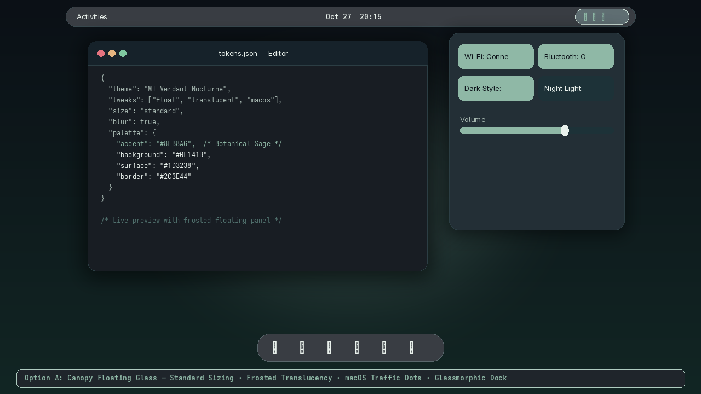
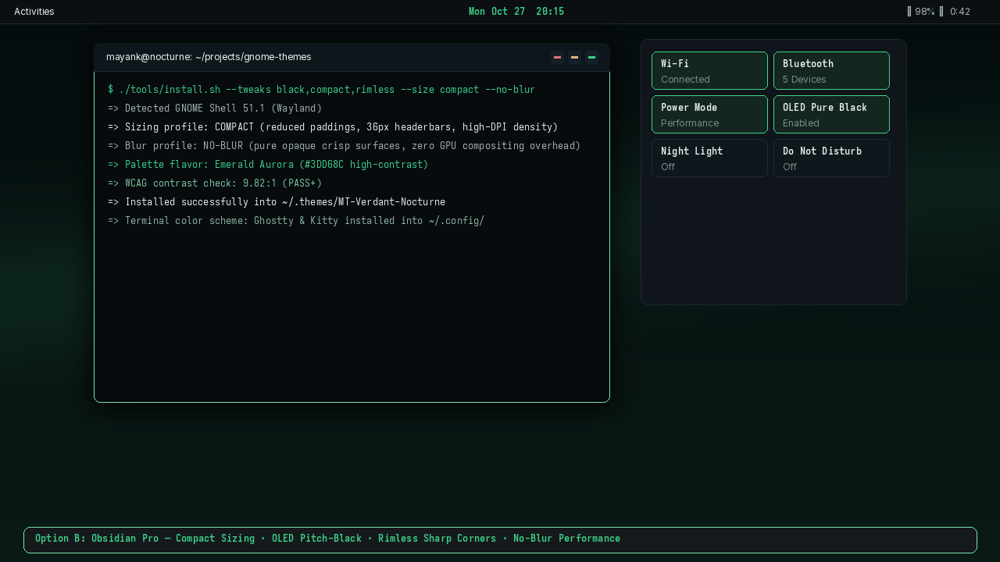
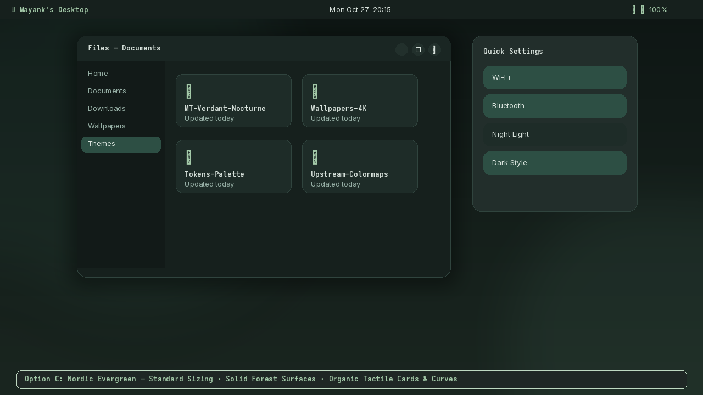
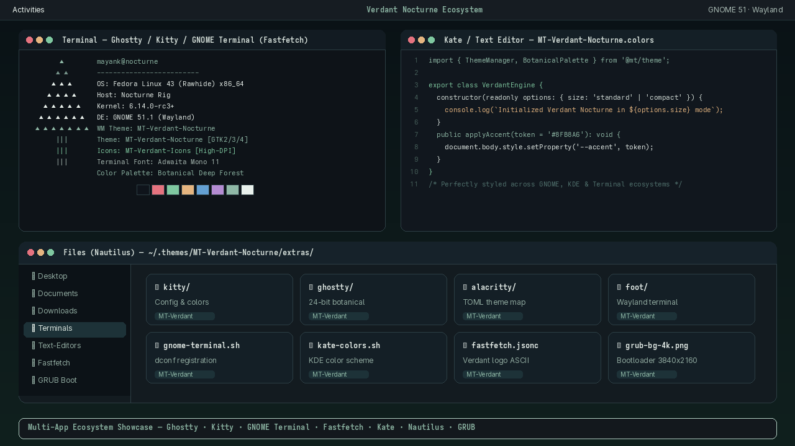
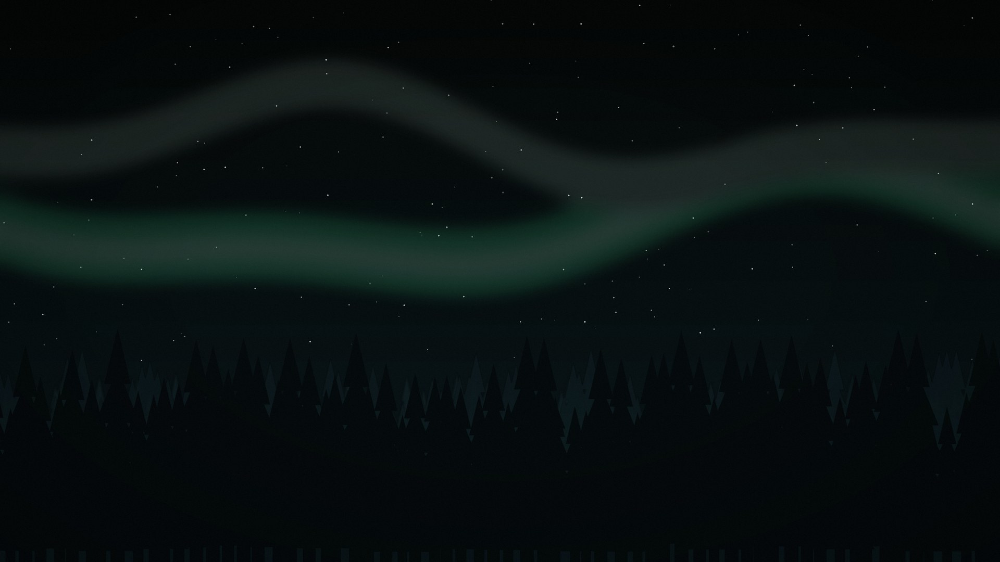
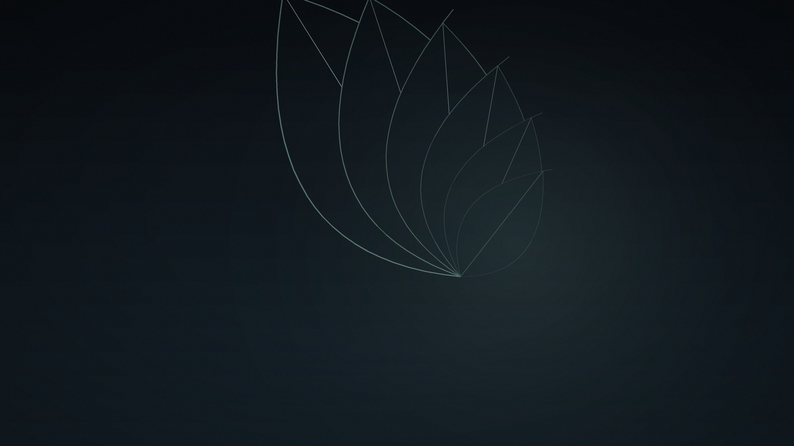
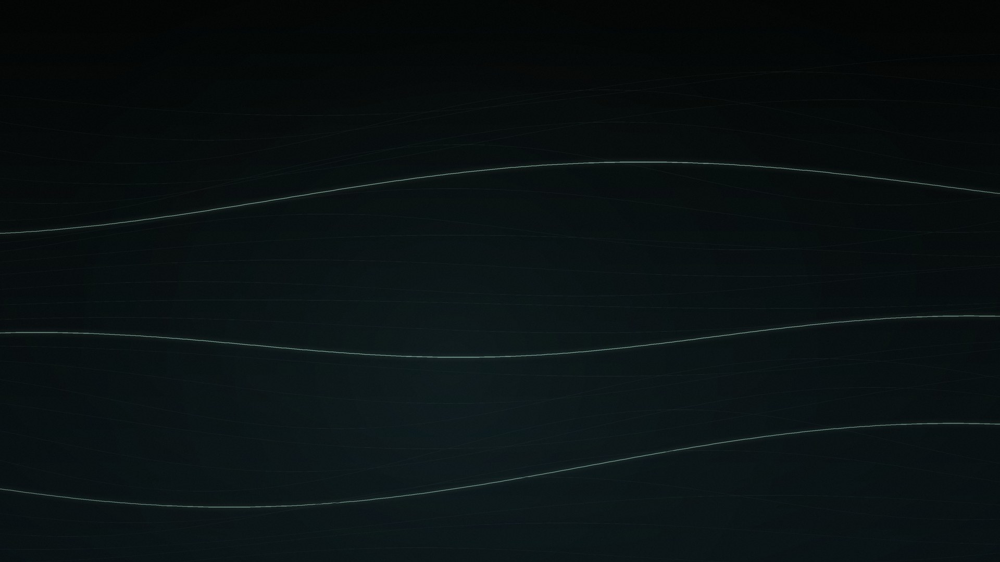

# MT Verdant Nocturne

© Mayanktaker Computers & Web Development | https://mayanktaker.com

A premium dark theme ecosystem for Linux desktops — GNOME Shell 50/51, GTK3, GTK4 (best-effort), and Flatpak — inspired by modern desktop aesthetics (Colloid, WhiteSur, TokyoNight, Catppuccin, Everforest). Featuring a quiet charcoal-teal "Botanical Canopy" palette, modular tweak flags, compact and standard sizing profiles, frosted glass and crisp no-blur modes, four procedural 4K wallpapers, an ultra-crisp icon pack, and native color schemes across popular terminals and desktop apps.

---

## Desktop Showcase & Design Variants

| **Option A: Canopy Floating Glass** |
|:---:|
|  |
| *Standard Sizing · Frosted Translucency · macOS Traffic Dots · Glassmorphic Dock & Popovers* |

| **Option B: Obsidian Pro (Compact & OLED)** |
|:---:|
|  |
| *Compact Sizing · OLED Deep Black · Rimless Crisp Corners · High-Density Headerbars* |

| **Option C: Nordic Evergreen (Organic Tactile)** |
|:---:|
|  |
| *Standard Sizing · Solid Forest Surfaces · Warm Tactile Cards & Curved Window Accents* |

| **Multi-App Ecosystem & Terminals Showcase** |
|:---:|
|  |
| *Ghostty · Kitty · GNOME Terminal · Fastfetch · Kate · GNOME Text Editor · Nautilus High-DPI Icons* |

---

## Highlights & Features

- **Modular `--tweaks` Engine**: Customize panel styles (`float`, `translucent`, `black`), window controls (`macos`, `square`, `round`, `rimless`), and layout density.
- **Sizing Density Profiles**:
  - `--size standard`: Balanced padding, generous touch targets, and comfortable typography.
  - `--size compact`: Reduced 36px headerbar padding, tighter list items, and high-DPI space optimization for laptops and developers.
- **Blur & Compositing Profiles**:
  - `--blur`: Glassmorphic frosted translucency with subtle backdrops on panels and popovers.
  - `--no-blur`: Opaque, high-contrast surfaces with zero compositor overhead and pristine legibility.
- **Botanical Accent Flavors**:
  - `sage` (Default): Botanical Sage (`#8FB8A6`)
  - `emerald`: Aurora Emerald (`#3DD68C`)
  - `moss`: Earthy Moss (`#98B99A`)
  - `pine`: Nordic Pine (`#5E9E92`)
- **4 Original Procedural 4K Wallpapers (3840×2160)**:
  1. *Botanical Canopy* (Midnight Fern & Moonlight)
  2. *Verdant Aurora* (Nordic Pines & Northern Lights)
  3. *Zen Flora* (Minimalist Bauhaus Leaf Contours)
  4. *Obsidian River* (Topographic Flowing Mineral Veins)
- **High-Definition Icon & Cursor Suite**:
  - `MT-Verdant-Icons`: Multi-stop botanical gradient folders with specular highlights, emerald badges, and custom system app icons (`org.gnome.Nautilus`, terminal, settings, calculator).
  - `MT-Verdant-Cursors`: Obsidian dark pointers with sage glowing tips.
- **Universal Application Support**: Ready-to-use color schemes for Kitty, Ghostty, Alacritty, Foot, GNOME Terminal, Fish Shell, Kate/KWrite, GNOME Text Editor, KDE Plasma, Fastfetch, GRUB bootloader, and Plymouth.

---

## 4K Wallpaper Gallery

| Botanical Canopy | Verdant Aurora |
|---|---|
|  |  |
| **Zen Flora** | **Obsidian River** |
|  |  |

---

## Installation & Setup Wizard (User-level, no root required)

User themes are installed exclusively into `~/.themes` and user icon/cursor packs into `~/.icons`.

### Interactive Setup Wizard (Recommended)
Simply run the installer without arguments to launch the friendly, step-by-step configuration wizard:

```sh
git clone https://github.com/Mayanktaker/mt-verdant-nocturne.git
cd mt-verdant-nocturne

# Run interactive wizard (prompts for tray style, controls, blur, density, accent, wallpapers):
./install.sh
```

### Direct CLI Installation (Human-Friendly Options)

```sh
# 1. Default Recommended: 16px Rounded Modern Island Tray Bar + Standard Clean Buttons:
./install.sh --panel round-island --controls standard

# 2. Floating Capsule Pill Bar + macOS Traffic Dots:
./install.sh --panel pill --controls macos

# 3. Connected Bottom-Rounded Top Bar (Screen-attached top edge, 16px curved bottom corners):
./install.sh --panel bottom-round

# 4. Classic Full-Width Edge-to-Edge Square Bar:
./install.sh --panel flat

# 5. Sizing and Blur Customization:
./install.sh --size compact --no-blur    # High density, crisp solid surfaces (laptops/low-GPU)
./install.sh --size standard --blur      # Balanced density, frosted glass translucency

# 6. Botanical Accent Colors:
./install.sh --accent sage               # Sage (#7FC8A0 - Balanced mint green, default)
./install.sh --accent emerald            # Emerald (#3DD68C - Vibrant forest green)
./install.sh --accent moss               # Moss (#9ECB74 - Warm olive foliage)
./install.sh --accent pine               # Pine (#3D8B7A - Deep twilight teal)

# 7. 4K Wallpapers (copies images to ~/Pictures/wallpapers-mt-verdant/):
./install.sh --wallpaper all

# 8. Scripting & Automation (Non-interactive mode):
./install.sh --non-interactive --panel round-island --controls standard --icons --gtk4-libadwaita
```

---

## Supported App Ecosystem & Color Schemes

All application themes are bundled under `extras/` and use the single source of truth color tokens from `palette/tokens.json`.

### Quick Setup: One-Click App Theme Installer
To automatically scan your system and apply matching color schemes to all detected terminals, shells, and text editors:
```sh
./tools/extras/install-all.sh
```

### Manual App Installation

- **Ghostty**:
  ```sh
  mkdir -p ~/.config/ghostty/themes
  cp extras/terminals/ghostty/mt-verdant-nocturne ~/.config/ghostty/themes/
  # In ~/.config/ghostty/config: theme = mt-verdant-nocturne
  ```
- **Kitty**:
  ```sh
  mkdir -p ~/.config/kitty/themes
  cp extras/terminals/kitty/mt-verdant-nocturne.conf ~/.config/kitty/themes/
  # In ~/.config/kitty/kitty.conf: include themes/mt-verdant-nocturne.conf
  ```
- **Alacritty**:
  ```sh
  mkdir -p ~/.config/alacritty/themes
  cp extras/terminals/alacritty/mt-verdant-nocturne.toml ~/.config/alacritty/themes/
  # In ~/.config/alacritty/alacritty.toml: import = ["~/.config/alacritty/themes/mt-verdant-nocturne.toml"]
  ```
- **Foot**:
  ```sh
  mkdir -p ~/.config/foot/themes
  cp extras/terminals/foot/mt-verdant-nocturne.ini ~/.config/foot/themes/
  # In ~/.config/foot/foot.ini: include = ~/.config/foot/themes/mt-verdant-nocturne.ini
  ```
- **GNOME Terminal**:
  ```sh
  # Automatically registers the "MT Verdant Nocturne" profile via dconf:
  bash extras/terminals/gnome-terminal/install.sh
  ```

### 2. Shells
- **Fish Shell**:
  ```sh
  bash extras/fish/install.sh
  fish_config theme choose "mt_verdant_nocturne"
  ```

### 3. Text Editors & IDEs
- **GNOME Text Editor / Gedit / GtkSourceView 4 & 5**:
  ```sh
  bash extras/text-editors/gnome-text-editor/install.sh
  # Select "MT Verdant Nocturne" under Text Editor Preferences -> Appearance.
  ```
- **KDE Kate & KWrite**:
  ```sh
  bash extras/text-editors/kate/install.sh
  # Select "MT Verdant Nocturne" in Kate Settings -> Configure Kate -> Color Themes.
  ```
- **VS Code**: Complete editor syntax and workbench theme located in `extras/vscode/`.

### 4. KDE Plasma & Qt Apps
- **KDE Plasma Color Scheme**:
  ```sh
  bash extras/kde/color-schemes/install.sh
  # Apply "MT Verdant Nocturne" in System Settings -> Colors & Themes -> Color Scheme.
  ```

### 5. Fastfetch CLI Showcase
- Run the custom nocturnal ASCII tree and specs:
  ```sh
  fastfetch -c extras/fastfetch/config.jsonc
  ```

### 6. Boot & Login Screens
- **GRUB Bootloader**:
  ```sh
  # Installs 4K nocturnal boot theme with styled selector box (requires sudo):
  sudo bash extras/grub/mt-verdant-nocturne/install.sh
  ```
- **Plymouth Boot Splash**:
  ```sh
  sudo bash extras/plymouth/mt-verdant-nocturne/install.sh
  ```
- **SDDM Greeter**: Complete QML theme located in `extras/sddm/mt-verdant-nocturne/`.
- **GDM Greeter**: GNOME Display Manager CSS located in `extras/gdm/`.

---

## Build from Source

```sh
# Verify WCAG contrast compliance (13/13 token pairs pass)
python3 tools/dev/check_contrast.py

# Generate 4K procedural wallpapers
python3 tools/wallpaper/generate.py

# Build High-Definition Icons & Cursors
python3 tools/icons/generate_icons.py
python3 tools/icons/generate_cursors.py

# Build GNOME Shell themes (GNOME 50 and 51)
python3 tools/shell/build.py --all

# Build GTK3 and GTK4 CSS
python3 tools/gtk/build.py

# Render desktop mockups and ecosystem showcase
python3 tools/dev/generate_mockups.py
```

---

## Layer & Component Matrix

| Layer | Status | Target Location |
|---|---|---|
| GNOME Shell 50/51 | Tested (floating pill bar, frosted glass, quick settings) | `~/.themes/MT-Verdant-Nocturne/gnome-shell/` |
| GTK3 Apps | Tested (circular dots, compact/standard, rimless, rounded) | `~/.themes/MT-Verdant-Nocturne/gtk-3.0/` |
| GTK2 Legacy | Fallback `gtkrc` for older apps (GIMP 2.10, Audacity) | `~/.themes/MT-Verdant-Nocturne/gtk-2.0/` |
| GTK4 / Libadwaita | Best-effort overrides via `--gtk4-libadwaita` | `~/.config/gtk-4.0/gtk.css` |
| Flatpak GTK3 | Sandboxed apps via `org.gtk.Gtk3theme.MT-Verdant-Nocturne` | `flatpak/` |
| 4K Wallpapers | 4 original procedural artworks | `${THEME_DIR}/wallpapers/` |
| Icon Theme | `MT-Verdant-Icons` (places + system apps) | `~/.icons/MT-Verdant-Icons/` |
| Cursor Theme | `MT-Verdant-Cursors` | `~/.icons/MT-Verdant-Cursors/` |
| Terminal Schemes | Kitty, Ghostty, Alacritty, Foot, GNOME Terminal | `extras/terminals/` |
| Shell Theme | Fish syntax highlighting | `extras/fish/` |
| Text Editors | GtkSourceView 4/5, Kate/KWrite, VS Code | `extras/text-editors/`, `extras/vscode/` |
| KDE / Qt | Plasma Color Scheme | `extras/kde/color-schemes/` |
| Boot Screens | GRUB (4K) & Plymouth animated splash | `extras/grub/`, `extras/plymouth/` |
| Greeters | SDDM (QML) & GDM (CSS) | `extras/sddm/`, `extras/gdm/` |

---

## Troubleshooting

- **Icons not refreshing in Nautilus or Dash?**
  Rebuild the user icon cache and toggle the icon theme:
  ```sh
  gtk-update-icon-cache -f -t ~/.icons/MT-Verdant-Icons
  gsettings set org.gnome.desktop.interface icon-theme 'Adwaita'
  gsettings set org.gnome.desktop.interface icon-theme 'MT-Verdant-Icons'
  ```
- **Shell styles not reloading on Wayland?**
  Toggle the User Themes extension via Extensions app or log out and back in to reload GNOME Shell CSS.

---

## License

- Code, CSS, and build scripts: [GPL-3.0](LICENSES/GPL-3.0.txt)
- Wallpapers, icons, and artwork: [CC BY-SA 4.0](LICENSES/CC-BY-SA-4.0.txt)
